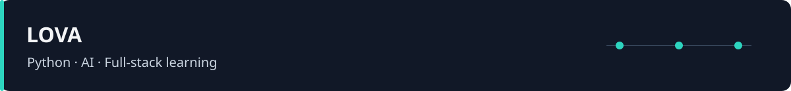

# Hi, I'm Lova

I'm studying Python, AI, machine learning, backend development and full-stack development. I learn by building applications, working through course exercises, and documenting what works and what still needs testing.

## Selected projects

| Project | What I am practicing |
| --- | --- |
| [Lova Money OS](https://github.com/LOVA-malamud/money-OS) | A Hebrew RTL finance application: exact money calculations, ledger rules, PostgreSQL data boundaries and browser tests. |
| [VISION · Face Mask CNN](https://github.com/LOVA-malamud/vision03-mask-ai) | A TensorFlow/Keras model connected to a FastAPI API and React UI, with shared preprocessing and recorded evaluation. |
| [CROWNFRONT](https://github.com/LOVA-malamud/Yuval_ZONA) | A Godot action-strategy game with AI behavior, reusable gameplay systems and simulation tools. |
| [Python Store](https://github.com/LOVA-malamud/learning-python) | Console and Pygame interfaces, input validation, state and JSON persistence. |

## My learning archive

- [Python, SQL and data-science classwork](https://github.com/LOVA-malamud/LOVA_M) — from collections and functions to queries and regression.
- [Course homework](https://github.com/LOVA-malamud/ekom_home_work) — assignments kept with their original dates and solutions.
- [Python exam](https://github.com/LOVA-malamud/exam_1_ekom) and [machine-learning exam notes](https://github.com/LOVA-malamud/machine_learning_exam_b) — practice and worked answers, including unfinished work.

## Tools I use while learning

**Python & data:** Python, NumPy, pandas, scikit-learn, TensorFlow/Keras.  
**Applications:** FastAPI, React, TypeScript, SQLite, PostgreSQL/Supabase.  
**Engineering practice:** Git, pytest, Vitest, Playwright, and Godot/GDScript for game development.

I'm working on making projects easier to run, test and understand. Each repository documents its own status and limitations. Some learning material and application interfaces are in Hebrew — עברית.
